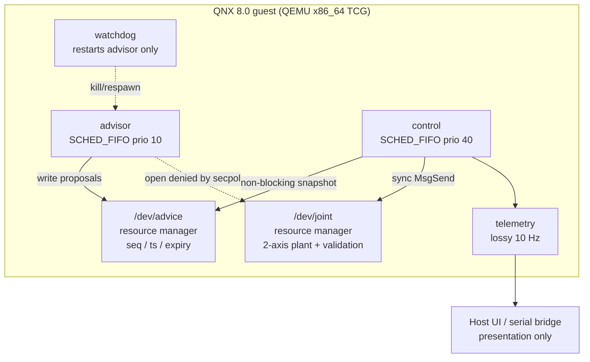

# Split Loop

**Not a medical device. Not certified. Not a patient-treatment product.**

A checkable laboratory cassette transfer on **QNX SDP 8.0** under **QEMU x86_64 (TCG)**. An instrument technician moves a sealed sample cassette from a rack slot to an analyzer dock without entering occupied neighbors, hitting the analyzer housing, or crossing a published jerk limit. An untrusted native profiler tries to beat a frozen conservative baseline on cycle time. The same image then shows what happens when that profiler is coupled naively (blocking `MsgSend`) versus isolated (non-blocking advice).

Entrant: **Pravinraj Vincent**, independent developer (Sunbury, Ohio). Individual submission to the QNX Global Hackathon 2026, **Robotics & Medical**.

## The ten-second number

On the acceptance image (`evidence/acceptance.json`, source SHA-256 `bf69654eb920ffb0dd1922593183e8de3c6cdb6c36f0e99d0c9f9f72e3c15621`):

| Run | What | Cycle (incl. settle) | Misses | Notes |
|---|---|---:|---:|---|
| `acceptance-r00-baseline-none-0` | Frozen Safe-via sequential trapezoid | **7.990243749 s** | 0 | DOCK, 0 keep-out / 0 jerk breaches |
| `acceptance-r01-planner-none-0` | Native profiler (isolated) | **2.959989901 s** | 0 | **62.95% shorter**, DOCK, ACCEPT only |
| `acceptance-r09-planner-hang-0` | Isolated advisor hang | — (HOME) | **0** | 1 advisor restart |
| `acceptance-r11-planner-hang-1` | Same hang, naive `MsgSend` | — (HOME) | **19** | max ask **186.795 ms**, max command completion 192.143 ms |
| OS policy | control open `/dev/joint` | — | — | control `fd=3` mode **0666**; advisor **EPERM** (`fd=-1`, errno 1) |

16 motion/fault cases + the OS denial all passed. **7,029** raw control samples are in `evidence/raw/`. These are **QEMU TCG guest CLOCK_MONOTONIC measurements**, not WCET and not a hardware real-time guarantee. The planner is a **native analytic profiler**, not a trained model; this project does not use an AI label for it.

A later live take (`evidence/CAPTURE-NOTES.md`, `evidence/live-session-02-parsed.json`) reproduced the legal transfer at **2.960191 s**, docked after a mid-transfer `kill -9` of the advisor with **0** misses and 1 restart, and saw naive hang **21** misses / max ask **190.876 ms**. Live values are never substituted for acceptance numbers.

## Why it matters

Lab automation cares when advice is late, stale, or hostile. A faster path is only useful while it is still current. Split Loop makes that visible: reason-coded accept/clamp/reject, a same-image A/B of naive versus isolated coupling, and an OS security-policy denial of the advisor opening `/dev/joint` (device mode stays 0666; the denial is not chmod and not an application `if`).

Isolation itself is **not** claimed as novel. See [Prior art](#prior-art).

## Architecture



Naive mode (same binary, same image) replaces the non-blocking advice snapshot with a synchronous `MsgSend` to the advisor. That is the A/B lesson, not a Linux comparison we did not run.

### Reason codes

`ACCEPT`, `CLAMP_JERK`, `REJECT_KEEP_OUT`, `REJECT_STALE`, `REJECT_REPLAY`, `REJECT_EXPIRED`, `REJECT_MALFORMED`, `FALLBACK_NO_ADVICE`.

Clamps are engineering controls, not formal safety and not a certified safety function.

## Versions (exact)

| Item | Value |
|---|---|
| QNX | **SDP 8.0.0** (guest banner from acceptance boot: `QNX qnx-smoke 8.0.0 2026/06/05-16:26:03EDT x86pc x86_64`) |
| Target | **QEMU x86_64**, TCG (`-accel tcg -cpu max`), 1 vCPU, 512 MiB RAM |
| Image tool | `mkqnximage --type=qemu --arch=x86_64 --boot-mode=qemu --secpol=secure` |
| Toolchain | **qcc** with **GCC 12.2.0**, default target `gcc_ntox86_64` (`-Vgcc_ntox86_64`); also available: `gcc_ntoaarch64le*` variants |
| Host used for acceptance | Debian 13, QEMU **10.0.13**, host `cc` 14.2.0, Python 3.13, Node 24 (syntax checks only). Debian is outside the documented supported SDP host set; native builds still worked here. |
| Control period | 10 ms (100 Hz), `CLOCK_MONOTONIC`, absolute sleeps |

Do **not** redistribute proprietary QNX IFS/disk images or SDP binaries. Rebuild under your own licensed SDP.

## Prerequisites

1. Licensed **QNX SDP 8.0** with `qnxsdp-env.sh` (sets `QNX_HOST`, `QNX_TARGET`).
2. `mkqnximage` on `PATH` (or under `$QNX_HOST` / the SDP host tree).
3. `qemu-system-x86_64` and `qemu-img`.
4. Host C compiler, Python 3, Node (for `node --check` only).
5. About **4 GiB** free disk before an image build.

## Build and run

```bash
# 1) Host-portable logic / plant / recovery tests (no QNX required)
./test-host.sh

# 2) Source SDP, build native binaries, build enforcing SMALL image
source /path/to/qnx800/qnxsdp-env.sh
./build.sh

# 3) Optional host UI (presentation only; box-local)
python3 ui/server.py   # http://127.0.0.1:8765

# 4) Re-run the acceptance command matrix on the guest
./run-evidence.sh
# Writes reports/run-<ts>.log, .json, -matrix.json and raw CSVs.
```

`scripts/build-image.sh` creates a disposable `images/split-loop` working tree, installs the smoke snippets, and runs `mkqnximage` with `--secpol=secure --policy=images/split-loop-policy.txt`. Generated `output/` and SSH host keys under `local/misc_files/` stay gitignored.

### Reproduce the published acceptance numbers

1. Build as above (do not change frozen geometry or baseline limits in `app/motion.c` / `design/split-loop.md`).
2. Run `./run-evidence.sh` (drives `scripts/acceptance.commands` over serial).
3. Compare `reports/run-*.json` to `evidence/acceptance.json`. Expect the same matrix shape; absolute timing will vary slightly under TCG on a shared host.
4. Raw CSV schema and timing definitions: `evidence/SETUP.md`.

Frozen baseline (Safe-via): Y to 180, X to 390, Y to 250; `v_max=80`, `a_max=200`, `j_max=600` (all below splash jerk 1500). Cycle clock and dock settle rules are in `design/split-loop.md`.

## Results table (acceptance)

| ID | Kind / fault / mode | Finish | Cycle s | Misses | Restarts | Key reasons |
|---|---|---|---:|---:|---:|---|
| r00 | baseline / none / 0 | DOCK | 7.990243749 | 0 | 0 | ACCEPT |
| r01 | planner / none / 0 | DOCK | 2.959989901 | 0 | 0 | ACCEPT |
| r02 | planner / keepout / 0 | HOME | — | 0 | 0 | REJECT_KEEP_OUT |
| r03 | planner / jerk / 0 | HOME | — | 0 | 0 | CLAMP_JERK |
| r04 | planner / stale / 0 | HOME | — | 1 | 0 | REJECT_STALE |
| r05 | planner / replay / 0 | HOME | — | 0 | 0 | REJECT_REPLAY |
| r06 | planner / expired / 0 | HOME | — | 0 | 0 | REJECT_EXPIRED |
| r07 | planner / malformed / 0 | HOME | — | 0 | 0 | REJECT_MALFORMED |
| r08 | planner / overload / 0 | HOME | — | 0 | 0 | FALLBACK_NO_ADVICE |
| r09 | planner / hang / 0 | HOME | — | 0 | 1 | FALLBACK_NO_ADVICE |
| r10 | planner / crash / 0 | DOCK | 2.959996718 | 0 | 1 | ACCEPT |
| r11 | planner / hang / 1 (naive) | HOME | — | 19 | 1 | FALLBACK_NO_ADVICE |
| r12 | baseline / none / 0 (slot 2) | DOCK | 6.239858396 | 0 | 0 | ACCEPT |
| r13 | planner / none / 0 (slot 2) | DOCK | 2.159923041 | 0 | 0 | ACCEPT |
| r14 | baseline / none / 0 (slot 3) | DOCK | 5.359851664 | 1 | 0 | ACCEPT |
| r15 | planner / none / 0 (slot 3) | DOCK | 1.869950967 | 0 | 0 | ACCEPT |
| policy | OS denial | — | — | — | — | control open allowed; advisor EPERM |

`matrix_pass: true` in `evidence/acceptance-matrix.json`. Incidental misses (r04, r14) stay in the matrix; they are not hidden.

## Source map

| Path | Role |
|---|---|
| `app/runtime.c` | `/dev/joint`, `/dev/advice`, FIFO control, advisor, watchdog, naive vs isolated, policytest |
| `app/motion.c` | Frozen geometry, keep-outs, jerk-limited trapezoid, second-order plant |
| `app/contract.c` | Native profiler, baseline comparison, advice contract, HOME recovery |
| `app/baseline.c` | Standalone Safe-via binary (`sl-baseline`) |
| `images/split-loop-policy.txt` | Enforcing secpol (`advisor_t` has no connect grant to `joint_mgr_t`) |
| `scripts/run-target.py` | QEMU serial driver |
| `scripts/parse_report.py` | Parses serial evidence; never invents passes |
| `scripts/acceptance.commands` | Exact guest command matrix |
| `ui/` | Host schematic (presentation) |
| `evidence/` | Published acceptance artefacts |
| `design/split-loop.md` | Locked claim and frozen definitions |

## Limitations

- Simulated plant on QEMU TCG. No hardware timing, no WCET, no medical/IVD validation, no certification claim.
- Finite fault matrix, not exhaustive input coverage.
- Guest networking/SSH are unused and emit known boot warnings; all interaction is serial.
- The simulated plant advances one 10 ms step per executed control iteration, so during a naive stall the arm does not coast; a real arm would. Do not read splash-free naive hangs as physical proof.
- Debian 13 host is outside the documented supported SDP host set.

## Prior art

Resource-manager isolation, an untrusted planner, a FIFO actuator loop, a watchdog, and runtime-assurance structure are already public. Isolation is **not** our novelty claim. We cite:

- [QNX-CortexCage](https://devpost.com/software/qnx-cortexcage) — QEMU resource-manager Simplex-style gate, low-priority planner, FIFO loop, watchdog, chaos injection.
- [moco / SafeGuard](https://devpost.com/software/gg-6zqrfd) — untrusted planner versus deterministic referee, jerk limiter, kill-the-AI, Simplex citation (cuHacking 7 / QNX catalog honorable mention).
- Seto, Krogh, Sha & Chutinan, *The Simplex architecture for safe online control system upgrades* (1998), https://doi.org/10.1109/acc.1998.703255

What we measured here, and lead with: a named cassette transfer with a frozen cycle-time metric, message-freshness reason codes (stale / replay / expired), a same-image naive-vs-isolated hang A/B with raw samples, and an OS policy denial with world-mode 0666 on `/dev/joint`. Their screens, figures, and reported microsecond numbers are not used.

## Optional offline UI

`ui/standalone.html` is not shipped in this package (it embeds full sample arrays). To rebuild it from a full acceptance report that still has samples:

```bash
# copy full reports/acceptance.json into reports/ first, then:
python3 ui/build-standalone.py
```

Live UI: `python3 ui/server.py` after `./build.sh`.

## License

MIT License — Copyright (c) 2026 Pravinraj Vincent. See `LICENSE`.

QNX SDP, `mkqnximage` output, and related proprietary files remain under BlackBerry/QNX terms and are **not** redistributed in this repository.

---

**Not a medical device. Not certified. Not a patient-treatment product.**
